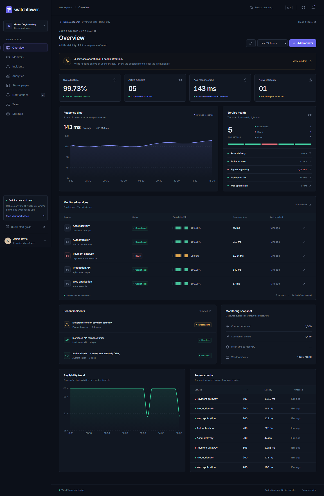
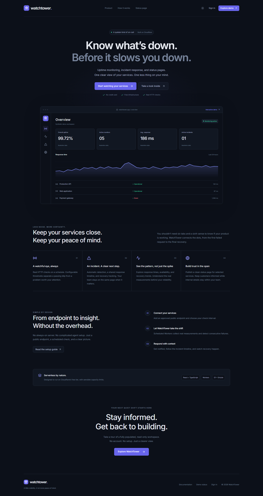
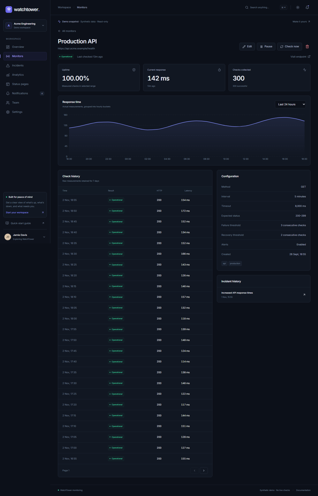
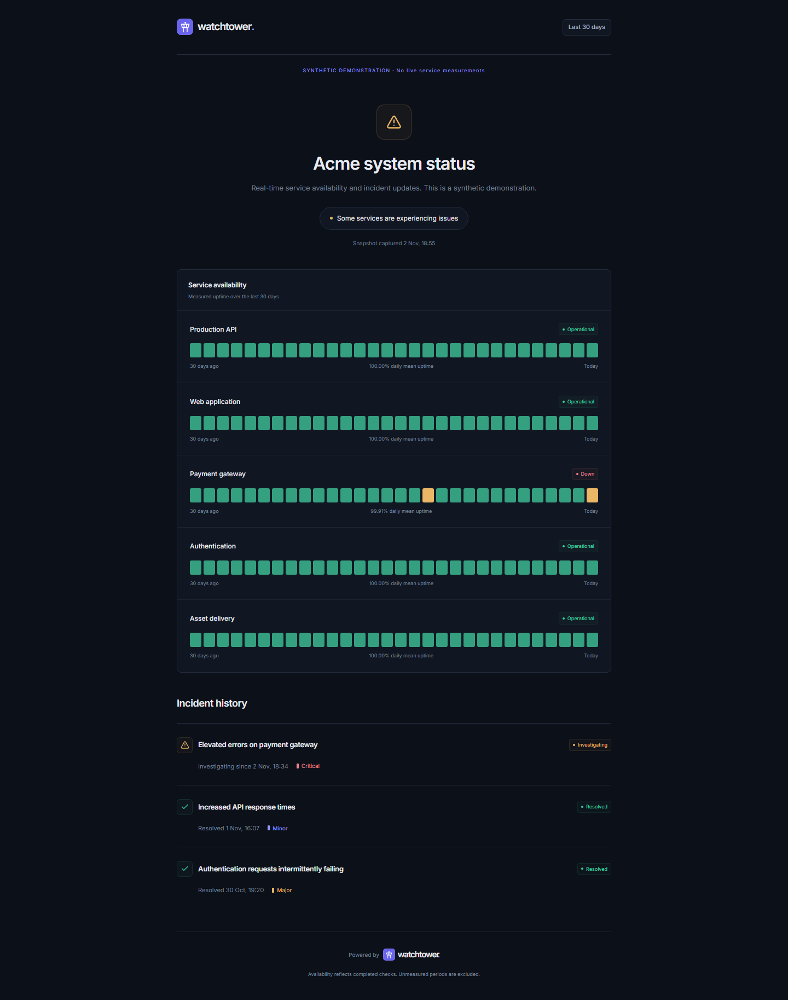
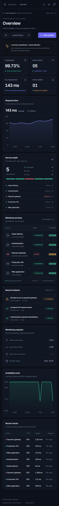
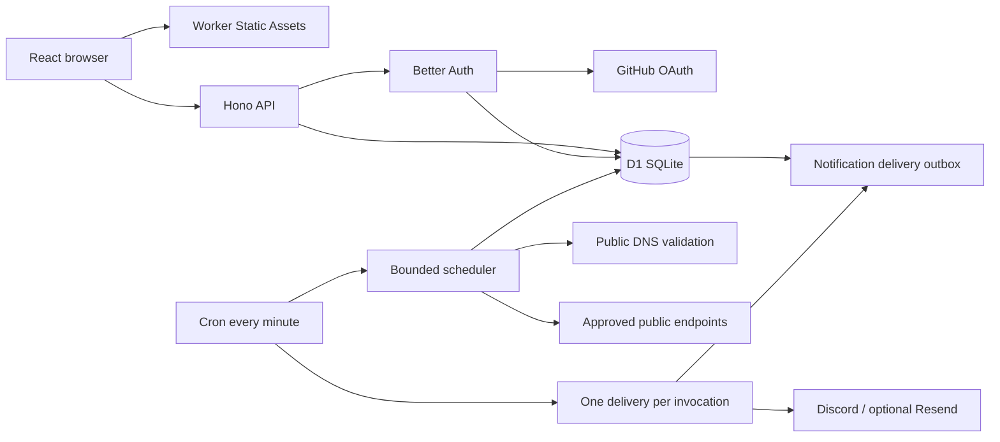
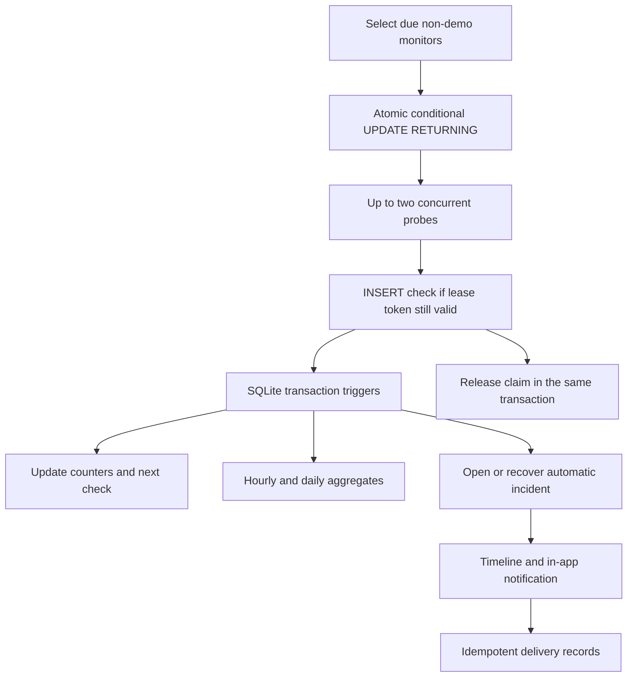

<p align="center"></p>
<h1 align="center">WatchTower</h1>
<p align="center">A little visibility. A lot more peace of mind.<br/>API monitoring, incident response, and public status pages on Cloudflare Workers.</p>

WatchTower is a full-stack TypeScript portfolio project with a real HTTP monitoring engine, persistent D1 measurements, workspace isolation, GitHub sign-in, and a credential-free synthetic demo. The application is prepared for deployment to your own Cloudflare account. **No deployment has been performed, and production OAuth, provider delivery, and free-plan CPU consumption still require live verification.** See [verification](docs/VERIFICATION.md) for the precise boundary.

## Quick start

Use Node.js **22.12+** and npm. All commands below run from the repository root. On PowerShell, use `npm.cmd` if script execution policy blocks `npm.ps1`.

```sh
npm install
npm run db:migrate:local
npm run db:seed
npm run dev
```

Open **http://localhost:5173**. Explore **/demo**, or the public demo status page at **/status/acme**. No credentials or paid services are required. The seed replaces only the `demo` organization, excluding real workspaces. Demo checks and aggregates are explicitly synthetic; scheduled execution never probes demo hosts.

To use real workspaces, copy `.dev.vars.example` to `.dev.vars`, configure GitHub OAuth, set a random session secret, and approve the exact endpoint hostnames you control. Restart development after changing variables. Local Cron events do not run automatically:

```sh
# In another terminal while the dev server runs:
npm run check:scheduled
```

The script uses the current Cloudflare Vite Local Explorer scheduled-event API. It is a local tool, not an exposed production administrative endpoint.

## Screenshots

Screenshots were captured from the running local application with seeded synthetic data; these are not design mockups.



<details><summary>Marketing website, monitor detail, public status, and mobile</summary>





</details>

## Implemented features

- Responsive marketing site, dark/light themes with persistence, local Inter fonts, mobile navigation with keyboard focus handling, command search, toasts, skeletons, error recovery, dialogs, empty states, 404 and restricted-access views.
- Better Auth GitHub OAuth integration with D1/Drizzle, signed cookie sessions, expiry, encrypted OAuth tokens, database-backed auth rate limiting, and logout. No development authentication bypass exists.
- Workspaces, workspace switching, owner/admin/member/viewer roles, secure hashed invitation links, email-bound acceptance, role changes, member removal, ownership transfer, workspace rename and deletion.
- Monitor creation, editing, deletion, pause/resume, queued manual checks, tags, timeouts, status ranges, thresholds, search, filters, ordering, pagination, configuration and measurement history.
- Real scheduled HTTP GET/HEAD probes; exact operator-approved hostnames, DNS safety checks, standard ports, no IP literals, no credentials, manual redirects, bounded timeouts, and cancelled response bodies.
- Atomic, expiring D1 claims; single-transaction check commits; failure/recovery counters; unique active automatic incidents; durable hourly/daily aggregates; bounded retention cleanup.
- Manual and automatic incidents, severities, validated lifecycle changes, timeline updates, automatic recovery, related service links, and historical activity.
- Server-side availability and latency analytics, SQL nearest-rank p50/p95, incident counts and MTTR, service comparison, 24h/7d/30d/90d views, and explicit unavailable-data states.
- In-app notification history, per-user read state and preferences, mark-all-read, encrypted Discord/email channels, test alerts, delivery history, exponential retry backoff, leases, and database outbox idempotency.
- Status-page creation, editing, publication/unpublication, accent selection, monitor selection and reordering, and public summaries that omit endpoint URLs, internal descriptions, and errors.
- Audit logs, validation, same-origin mutation protection, input/body limits, security headers, CI, versioned migrations, local seeding, deployment instructions, and automated tests.

## Stack and architecture

| Layer | Technology |
| --- | --- |
| Browser | React 19, TypeScript, Vite 7, React Router, TanStack Query |
| UI | Tailwind CSS 4, local shadcn-style Radix primitives, Lucide, Recharts, Sonner |
| Forms | React Hook Form, Zod 4 shared schemas |
| API | Hono on Cloudflare Workers, same origin as static assets |
| Authentication | Better Auth 1.7, GitHub OAuth, Drizzle D1 adapter |
| Persistence | Cloudflare D1/SQLite, Drizzle schema and generated base migration, SQL invariants |
| Background work | Workers Cron, D1 leases and transactional triggers, durable notification outbox |
| Tests | Vitest 5, React Testing Library, Miniflare/workerd D1, Playwright Chromium desktop/mobile |





### Database overview

The Drizzle schema defines 21 tables. Users, sessions, accounts and verification records support Better Auth. Organizations own memberships, invitations, monitors, incidents, channels, notifications, pages, and audit logs. Checks and aggregates belong to monitors; events belong to incidents; page membership has explicit ordering. Foreign keys cascade dependent operational data; incident history survives monitor deletion with a null monitor reference. A partial unique index prohibits duplicate active system incidents. Database triggers reject cross-tenant incident/page associations and invalid configurations. See [schema](worker/db/schema.ts), [migrations](migrations), and [engineering decisions](docs/ARCHITECTURE.md).

### Monitoring and incident semantics

| Monitor state | Meaning |
| --- | --- |
| Pending | Newly created/resumed; no completed check in this monitoring session |
| Operational | Latest check succeeded; if recovering from down, the configured success threshold was reached |
| Degraded | Consecutive failures below the failure threshold |
| Down | Failure threshold reached; remains down until enough consecutive successes |
| Paused | Excluded from scheduling and active capacity |
| Unknown | API presentation state when the last measurement is older than `max(15 minutes, 3 × interval)` |

Automatic incidents open in `investigating` after enough consecutive failures. Updates can move to `identified`, `monitoring`, or `resolved`, with forward/recovery transitions defined in `worker/monitoring/state.ts`. Recovery resolves only **system** incidents; manually declared incidents remain under human control. Resolved incidents cannot reopen. A new incident may be created for a later continuing failure after an operator manually resolves a system incident.

Checks measure time until headers; failing checks record time until failure, including timeout/DNS validation failures. Uptime is the ratio of successful to completed checks, not a time-weighted SLA. Unmeasured intervals contribute no success or failure. Hourly/day boundaries are UTC. Selected windows include the entire first hourly/daily bucket, and available samples may cover less than the selected range. Percentiles use actual retained raw checks only, with a minimum of 20 samples; they are unavailable for 30/90-day windows. MTTR averages durations of resolved incidents that started in the selected window.

## Configuration

Bindings and non-secret defaults are in `wrangler.jsonc`. Secrets go in ignored `.dev.vars` locally and Wrangler secrets in production.

| Variable | Requirement / default |
| --- | --- |
| `APP_URL` | Exact browser origin; local `http://localhost:5173`, production your HTTPS workers.dev origin |
| `BETTER_AUTH_SECRET` | At least 32 random characters; required for real accounts |
| `GITHUB_CLIENT_ID`, `GITHUB_CLIENT_SECRET` | Required for GitHub sign-in; demo works without them |
| `APPROVED_MONITOR_HOSTS` | Comma-separated exact public hostnames approved by deployment operator; empty fails closed |
| `MAX_WORKSPACE_MONITORS` | Default 5, effective maximum 5 active monitors per workspace |
| `MAX_GLOBAL_MONITORS` | Default 10; effective maximum also bounded by `CHECK_BATCH_SIZE × 5` |
| `CHECK_BATCH_SIZE` | Default/max 2 probes per minute, concurrency 2 |
| `CHANNEL_ENCRYPTION_KEY` | Optional until adding channels; 32 random bytes encoded as base64 |
| `RESEND_API_KEY`, `RESEND_FROM` | Optional email only; requires verified sender/domain |
| `ENVIRONMENT` | Informational deployment label; never enables an auth bypass |

Prefer HTTPS endpoints. HTTP on port 80 is supported but exposes traffic to the network. Only approve hostnames with trusted DNS administration. The implementation cannot pin the platform fetch resolver to the DNS-over-HTTPS answer; operator approval is the security boundary against DNS rebinding. It is **not** automated proof of domain ownership. See [SECURITY.md](SECURITY.md).

## Commands and testing

```sh
npm run dev                    # Vite + local Worker/D1
npm run build                  # Browser assets + Worker deployment bundle
npm run preview                # Preview production bundle locally
npm run typecheck
npm run lint
npm test                       # Unit, UI, real D1 integration, controlled HTTP fixtures
npx playwright install chromium
npm run test:e2e                # Desktop and mobile Chromium
npm run db:generate            # Generate future Drizzle schema migrations
npm run db:migrate:local
npm run db:seed                 # Synthetic local organization only
npm run check:scheduled         # Local scheduled handler via Local Explorer
npm audit
npm run measure:local           # Isolated local D1 transaction metadata
```

Tests validate signed Better Auth sessions stored in real local D1, not a production authentication bypass. External providers are mocked at request boundaries; controlled local HTTP fixtures test actual network requests and abort behavior. Playwright uses the local seeded app. CI installs Chromium and runs the full suite without cloud credentials. [Verification details](docs/VERIFICATION.md) distinguish implemented, locally tested, and live-unverified behavior.

The read-only demo is a stored snapshot. Its time filters are relative to that snapshot, and its fixture records are excluded from real-data retention cleanup. Real accounts always use current time and measured data. Rerun the local/remote seed when you deliberately want a newer demo snapshot.

## Deployment, security, and resume

Follow [DEPLOYMENT.md](DEPLOYMENT.md) to deploy to your own **free** Cloudflare account and workers.dev hostname. Remote migrations and deployment are explicit commands and never occur in local startup or CI. Review [SECURITY.md](SECURITY.md), [API contracts](docs/API.md), and [RESUME.md](RESUME.md).
